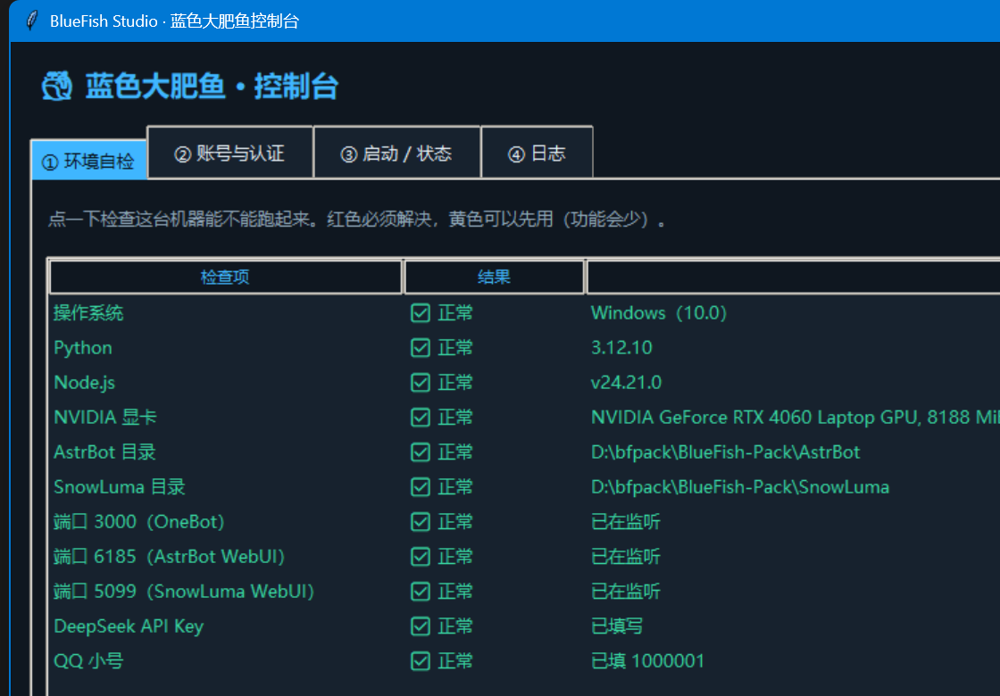
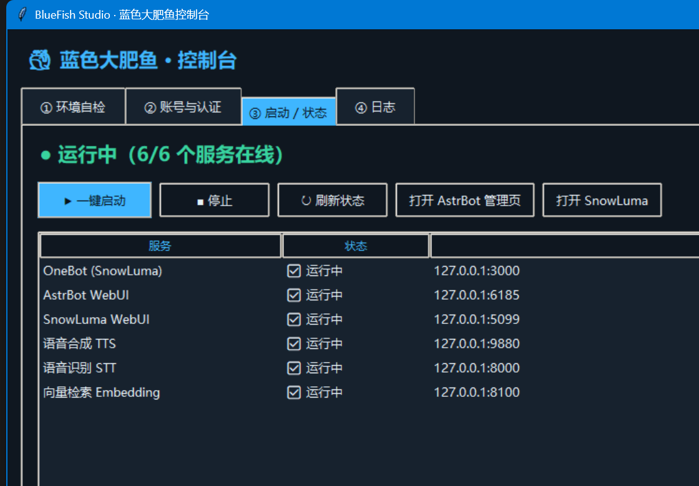
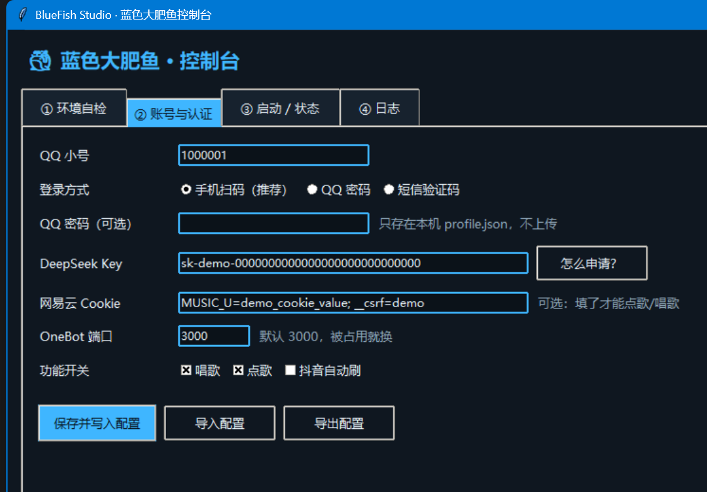
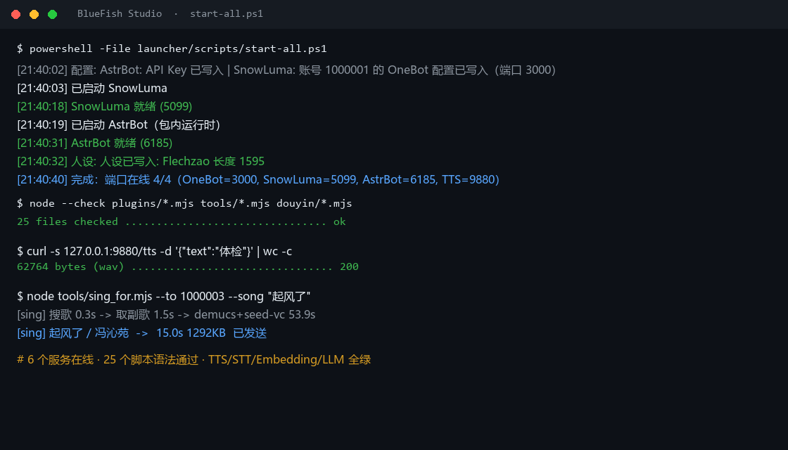
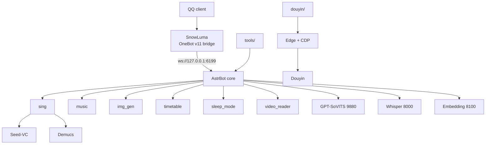

<p align="center">
  <h1 align="center">🐳 BlueFish</h1>
</p>

<p align="center">
  <strong>A QQ bot that sings, draws, reports your class schedule — and autonomously scrolls &amp; posts on Douyin.</strong>
</p>

<p align="center">
  Runs entirely on your own Windows machine: persona, voice, song voice-conversion, video understanding, automation.
</p>

<p align="center">
  
  
  
  
  
</p>

<p align="center"><sub>
  Unofficial project. QQ third-party bridging is a grey area — use a secondary account and follow platform rules.<br>
  English · <a href="README.md">中文</a>
</sub></p>

---

## Screenshots

<p align="center">
  
  
</p>

<p align="center">
  
  
</p>

<p align="center"><sub>From a demo instance — QQ number, API key and cookie are fake.</sub></p>

---

## What this is

BlueFish is a runnable QQ bot implementation, not a thin wrapper around a chat API.

It combines three things that usually live apart:

1. **Persona-driven conversation** — custom system prompt + local knowledge-base memory + group chat context + 8% chance of chiming in unprompted
2. **Heavy local inference** — GPT-SoVITS speaks in her own voice; Seed-VC + Demucs convert a real singer's vocal into her voice
3. **Real-world actions** — scheduled Douyin scrolling & posting (TTS narration + AI images + burned-in subtitles), Bilibili clip uploads, timetable reminders, roll-call @all

Two ways to consume it:

| Kind | Location | Usage |
|---|---|---|
| **AstrBot plugins** | `plugins/` | Drop into `AstrBot/data/plugins/` |
| **Standalone toolchain** | `tools/` `douyin/` `launcher/` | CLI, no AstrBot required |

> Why: a character in QQ should have a body — her own voice, the ability to speak up at 3 a.m., and a life in places you can't see.

---

## Features

### Singing (the core trick)

Search a song → grab the 15 s chorus → **Demucs** splits vocals/instrumental → **Seed-VC** (F0 44k singing model) converts the original vocal into her timbre → mix and send.

- Spoken-word / audiobook versions are **skipped automatically** (median note < 0.22 s with > 35 notes)
- Tries up to 12 candidates; penalizes wrong artists; blacklists covers, karaoke, readings
- Only **whole-octave** shifts, so auto pitch correction never makes it sound off-key
- Works in group chats; `sing_for.mjs` sings for any friend on demand

### Music requests

"点歌 <song>" → NetEase 320k direct link → 40 s chorus. Falls back to another version when the original is VIP-only; 8/day per user, 40/day global.

### Drawing

Alibaba Wanx `wanx2.1-t2i-turbo`, triggered by "画/画一张/文生图/帮我画".

### Conversation

- DeepSeek chat with a terse, stubborn, non-customer-service persona
- Knowledge-base long-term memory (persona, friend profiles, group lore, activity stats)
- **Group context**: injects the last 80 messages (300-message buffer)
- **Proactive replies**: 8% chance to join a conversation without being @-mentioned
- "Typing…" indicator and 0.8–4 s human-like delay

### Hearing

- Voice messages → local Whisper transcription
- Private short videos (≤3 min) → 9-grid keyframes + VLM caption + audio transcript

### Timetable

7:30 daily briefing, 15-minute pre-class reminder, Sunday nag to fill next week, **computed from the real date** (never confuses Thursday with Friday). Ask "tomorrow / this week / the week after".

### Douyin automation

Driven by local Edge + CDP (**no Playwright**), persistent profile so login survives:

- Scheduled feed scrolling (skips live streams, respects like quotas)
- Auto-posting image/video posts (one-shot pipeline: TTS narration + AI images + burned subtitles + transitions)
- Searches similar videos, then DeepSeek writes the copy

### Reminders & notifications

- Roll-call reminder: Mon–Fri 22:00, DM + **@all** in group
- Sleep mode: 00:00–08:00 replies "sleeping" and queues messages, answered in the morning
- `notify-qq`: any script or workspace can make her send a QQ message

### Stickers

Semantic retrieval with context-aware selection (`meme_manager`).

---

## Architecture



| Component | Port | Role |
|---|---|---|
| SnowLuma | 5099 / 3000 / 3001 | QQ ↔ OneBot bridge |
| AstrBot | 6185 / 6199 | Conversation core + plugin host |
| GPT-SoVITS | 9880 | Her voice TTS |
| Whisper | 8000 | Speech recognition |
| Embedding | 8100 | Knowledge-base vector search |

---

## Quick start

### Requirements

- Windows 10/11 x64
- Python 3.12, Node 20
- [AstrBot](https://github.com/AstrBotDevs/AstrBot) + [SnowLuma](https://github.com/SnowLuma/SnowLuma)
- For voice/singing: NVIDIA GPU with 6 GB+ VRAM, plus GPT-SoVITS and Seed-VC checkpoints

### Three steps

```powershell
# 1. Plugins
Copy-Item plugins\* "$env:BF_HOME\data\plugins\" -Recurse

# 2. Config (copy the template, fill in your own values)
Copy-Item configs\cmd_config.example.json "$env:BF_HOME\data\cmd_config.json"
#   fill: DeepSeek API key, OneBot token

# 3. Start
#   GUI: launcher\启动.vbs
#   CLI: powershell -File launcher\scripts\start-all.ps1
```

On first launch, open `http://127.0.0.1:5099` (SnowLuma) and scan the QR code with your secondary QQ account.

### Text-only mode

Without the model weights everything else still works: chat, drawing, music requests, timetable, reminders, stickers. Voice degrades to text automatically.

---

## Configuration

Scripts read environment variables; the repo contains no real credentials:

| Variable | Default | Purpose |
|---|---|---|
| `ONEBOT_HOST` | `http://127.0.0.1:3000/` | OneBot HTTP endpoint |
| `ONEBOT_TOKEN` | — | OneBot access token |
| `BF_HOME` | `D:/AstrBot` | AstrBot data directory |
| `BF_KB_JWT_SECRET` | — | JWT secret for knowledge-base writes |
| `SNOWLUMA_HOME` | `D:/SnowLuma` | SnowLuma directory |

Bring your own: DeepSeek API key, OneBot token, NetEase cookie (`MUSIC_U`, needed for music/singing).

---

## Layout

```
plugins/           AstrBot plugins (sing / music / img_gen / sleep_mode / timetable_context / video_reader)
tools/             Standalone tools (notify / timetable / sing-for / group profiles / roll-call)
douyin/            Douyin automation (feed scrolling, posting, video pipeline)
launcher/          Desktop console + install/start/stop scripts
configs/           Config templates (all CHANGE_ME)
docs/              Feature overview
```

---

## Roadmap

- [ ] More screenshots / a demo video
- [ ] One-click offline installer (portable Python + Node + deps)
- [ ] A/B the singing voice across candidates
- [ ] Weekly group-activity report
- [ ] OneBot v12 and other bridges

---

## Contributing

Issues and PRs welcome. Before submitting:

1. Never commit tokens, cookies, QQ numbers, or chat logs
2. Python must pass `python -m py_compile`; Node must pass `node --check`
3. For platform-automation changes, describe how you verified them

---

## Credits

- [AstrBot](https://github.com/AstrBotDevs/AstrBot) — conversation core and plugin framework
- [SnowLuma](https://github.com/SnowLuma/SnowLuma) — QQ NT ↔ OneBot bridge
- [GPT-SoVITS](https://github.com/RVC-Boss/GPT-SoVITS) — voice-cloning TTS
- [Seed-VC](https://github.com/Plachtaa/seed-vc) — singing voice conversion
- [Demucs](https://github.com/facebookresearch/demucs) — source separation
- [whisper](https://github.com/openai/whisper) — speech recognition

---

## Disclaimer

- Not affiliated with Tencent or DeepSeek
- QQ third-party bridging sits in a grey area: **use a secondary account, keep the rate low, follow platform rules**
- Douyin / NetEase automation may trigger risk controls; use at your own risk
- For learning and personal use only; no warranty

## License

[MIT](LICENSE)
