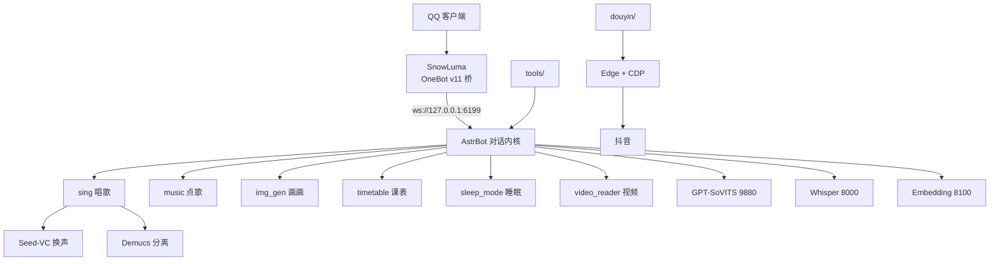

<p align="center">
  <h1 align="center">🐳 BlueFish · 蓝色大肥鱼</h1>
</p>

<p align="center">
  <strong>一只会唱歌、会画画、会报课表、还会自己刷抖音发作品的 QQ 机器人。</strong>
</p>

<p align="center">
  跑在你自己的 Windows 电脑上 —— 人设、声音、唱歌换声、视频理解、自动化，全部本地。
</p>

<p align="center">
  
  
  
  
  
</p>

<p align="center"><sub>
  第三方 QQ 客户端桥接属灰色地带：本项目仅用于个人学习自用，请使用小号并遵守平台规则。<br>
  中文 · <a href="#简介">简介</a> · <a href="#快速开始">快速开始</a> · <a href="#功能">功能</a> · <a href="#架构">架构</a>
</sub></p>

---

## 简介

**BlueFish** 是一套可直接运行的 QQ 机器人实现，不是一个"调 API 的聊天壳"。

它把三件通常互相割裂的事情拼到了一起：

1. **人格化的对话** —— 自写人设 + 本地知识库长期记忆 + 群聊上下文 + 8% 概率主动接话
2. **重本地推理** —— GPT-SoVITS 用自己的音色说话，Seed-VC + Demucs 把原唱"换声"成她唱
3. **真实世界动作** —— 定时刷抖音、发作品（TTS 配音 + AI 配图 + 硬字幕）、B 站切片、课表提醒、打卡 @全体

代码分成两类，可以各取所需：

| 类型 | 位置 | 用法 |
|---|---|---|
| **AstrBot 插件** | `plugins/` | 丢进 `AstrBot/data/plugins/` 即可用 |
| **独立工具链** | `tools/` `douyin/` `launcher/` | 命令行调用，不依赖 AstrBot |

> 为什么做这个：想让 QQ 里的角色"有身体"——能发出自己的声音、能在半夜主动说一句、能在你看不见的时候去别的地方活动。

---

## 功能

### 🎤 唱歌（核心特色）

搜歌 → 取 15 秒副歌 → **Demucs** 分离人声/伴奏 → **Seed-VC**（F0 44k 歌声模型）把原唱人声换成她的音色 → 混音发出。

- 念白/朗读版**自动跳过**（用音符密度判断：中位音符 < 0.22s 且音符数 > 35）
- 一次取 12 个候选依次试，歌手不符重罚，翻唱/伴奏/朗读进黑名单
- 只做**整八度**移位，避免半音自动校正导致的跑调
- 群里也能唱；`sing_for.mjs` 可以一键唱给指定好友

### 🎵 点歌

「点歌 歌名」→ 网易云 320k 直链 → 40 秒副歌。会员曲没版权自动换版本；每人 8 首/天、全局 40 首。

### 🎨 画画

通义万相 `wanx2.1-t2i-turbo`，「画/画一张/文生图/帮我画」触发。

### 🧠 聊天

- DeepSeek 对话，人设为"嘴硬、短句、不用客服腔"
- 知识库长期记忆（人设 / 好友画像 / 群设定 / 活跃度档案）
- **群聊上下文**：注入最近 80 条，300 条容量
- **主动接话**：8% 概率在没被 @ 时也接一句
- 私聊「正在输入」+ 0.8~4 秒拟人延迟

### 👂 听

- 语音消息 → 本地 Whisper 转写
- 私聊短视频（≤3 分钟）→ 九宫格关键帧 + VLM 描述 + 音轨转写

### 📅 课表

早报 7:30、课前 15 分钟提醒、周日催补、**按真实日期现算**（不会把周四的课答成周五）。
支持问「明天 / 本周 / 下下周 / 下一节」。

### 📱 抖音自动化

用本机 Edge + CDP 驱动（**不装 Playwright**），独立 profile 登录一次长期有效：

- 定时刷推荐流（自动跳直播、按配额点赞）
- 自动发图文/视频（一键出片：TTS 配音 + 4 张 AI 配图 + 硬字幕 + 转场）
- 搜索同类视频 → DeepSeek 参照写文案

### 🔔 提醒与通知

- 打卡提醒：周一到周五 22:00，私聊 + 群里 **@全体成员**
- 睡眠话术：0–8 点回「睡觉中」并记账，早上补回
- `notify-qq`：任何脚本/工作区跑完任务都能让她发 QQ

### 💬 表情包

语义检索 + 按语境自动配图（`meme_manager`）。

---

## 架构



| 组件 | 端口 | 作用 |
|---|---|---|
| SnowLuma | 5099 / 3000 / 3001 | QQ ↔ OneBot 桥 |
| AstrBot | 6185 / 6199 | 对话内核 + 插件宿主 |
| GPT-SoVITS | 9880 | 她的音色 TTS |
| Whisper | 8000 | 语音识别 |
| Embedding | 8100 | 知识库向量检索 |

---

## 快速开始

### 前置

- Windows 10/11 64 位
- Python 3.12、Node 20
- [AstrBot](https://github.com/AstrBotDevs/AstrBot) + [SnowLuma](https://github.com/SnowLuma/SnowLuma)
- 想要语音/唱歌：NVIDIA 显卡 6 GB+，以及 GPT-SoVITS、Seed-VC 模型

### 三步

```powershell
# 1. 插件
Copy-Item plugins\* "$env:BF_HOME\data\plugins\" -Recurse

# 2. 配置（复制模板，填自己的值）
Copy-Item configs\cmd_config.example.json "$env:BF_HOME\data\cmd_config.json"
#   需要填：DeepSeek API Key、OneBot token

# 3. 启动
#   图形化：launcher\启动.vbs
#   命令行：powershell -File launcher\scripts\start-all.ps1
```

第一次启动后，去 `http://127.0.0.1:5099`（SnowLuma）扫码登录 QQ 小号。

### 只有文本能力时

不装语音/唱歌模型也能跑：聊天、画画、点歌、课表、提醒、表情包全部可用，语音自动退化为文字。

---

## 配置

所有脚本从环境变量读取，仓库内无任何真实密钥：

| 变量 | 默认 | 用途 |
|---|---|---|
| `ONEBOT_HOST` | `http://127.0.0.1:3000/` | OneBot HTTP 地址 |
| `ONEBOT_TOKEN` | — | OneBot 访问令牌 |
| `BF_HOME` | `D:/AstrBot` | AstrBot 数据目录 |
| `BF_KB_JWT_SECRET` | — | 写知识库用的 JWT 密钥 |
| `SNOWLUMA_HOME` | `D:/SnowLuma` | SnowLuma 目录 |

需要自备的凭证：DeepSeek API Key、OneBot token、网易云 Cookie（`MUSIC_U`，点歌/唱歌用）。

---

## 目录

```
plugins/           AstrBot 插件（sing/music/img_gen/sleep_mode/timetable_context/video_reader）
tools/             独立工具（通知/课表/唱歌/群画像/打卡）
douyin/            抖音自动化（刷视频、发图文/视频、出片管线）
launcher/          桌面控制台 + 安装/启停脚本
configs/           配置模板（全部 CHANGE_ME）
docs/              功能总览
```

---

## 路线图

- [ ] 截图与演示视频（README 用）
- [ ] 一键安装包（便携 Python + Node + 依赖，离线可用）
- [ ] 唱歌的多版本 A/B（同一句不同音色对比）
- [ ] 群活跃度自动周报
- [ ] 更多平台桥接（OneBot v12）

---

## 贡献

欢迎 Issue / PR。提交前请：

1. 不要提交任何 token、Cookie、QQ 号、聊天记录
2. Python 文件过 `python -m py_compile`，Node 文件过 `node --check`
3. 涉及平台自动化的改动，请说明验证方式

---

## 致谢

本项目站在这些开源项目肩上：

- [AstrBot](https://github.com/AstrBotDevs/AstrBot) —— 对话内核与插件框架
- [SnowLuma](https://github.com/SnowLuma/SnowLuma) —— QQ NT ↔ OneBot 桥
- [GPT-SoVITS](https://github.com/RVC-Boss/GPT-SoVITS) —— 音色克隆 TTS
- [Seed-VC](https://github.com/Plachtaa/seed-vc) —— 歌声转换
- [Demucs](https://github.com/facebookresearch/demucs) —— 人声分离
- [whisper](https://github.com/openai/whisper) —— 语音识别

---

## 免责声明

- 本项目与腾讯、深度求索无任何隶属或合作关系
- QQ 第三方客户端桥接属于平台灰色地带，**请使用小号、控制频率、遵守平台规则**
- 抖音/网易云等平台自动化可能触发风控，风险自负
- 代码仅供学习交流，作者不对使用后果负责

## License

[MIT](LICENSE)
